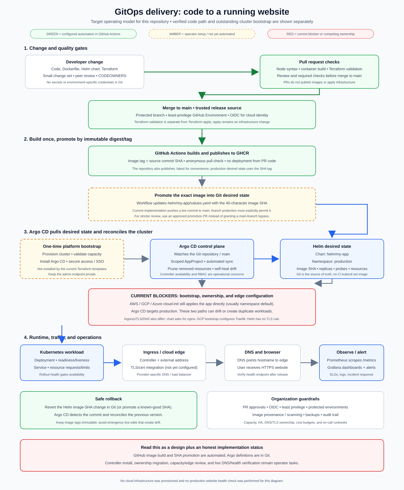

# Multi-Cloud GitOps Portfolio Framework

This portfolio/demo repository contains a Node.js app and example delivery and infrastructure paths for **AWS, GCP, and Azure**. It is not a production-ready reference architecture, and cloud usage is not guaranteed to be free. Review current provider pricing, account eligibility, region limits, network egress, and resource lifecycle before provisioning anything.

## 📂 Framework Contents
* **`src/`**: Node.js portfolio app, health and Prometheus endpoints, and container build.
* **`terraform/`**: Cloud-specific platform modules and optional database examples. The dev platform selects one cloud per run.
* **Pipelines**: GitHub Actions workflows plus Jenkins, GitLab CI, and Azure Pipelines examples. Configure credentials and security scanners before relying on them.
* **GitOps & monitoring**: Helm, Argo CD/Flux, Ansible, and Grafana examples.

## Portfolio CI/CD

The GitHub Actions workflow in `.github/workflows/docker-image.yml` checks the Node app and container, validates each cloud module and the shared dev Terraform configuration, then publishes an immutable GHCR image. Pull requests do not publish or deploy. A push to `main` publishes the image tagged with that commit SHA, verifies that it can be pulled anonymously, and promotes that immutable tag into `helm/my-app/values.yaml`; Argo CD can then reconcile the Git change. The workflow also applies infrastructure to the single cloud named by the repository variable `DEPLOY_CLOUD` (`aws`, `gcp`, or `azure`). Manual runs can select a cloud and apply infrastructure only when the `deploy` option is enabled. The optional Cloudflare DNS input is off by default.

The current AWS and Azure cloud-init examples run the application on a single VM. Changing the image tag in Terraform can replace that VM and cause downtime; this direct bootstrap path is not a zero-downtime production rollout. GitHub Environment protection rules can add an approval gate before any infrastructure apply proceeds.

The static profile generator can also be published with `.github/workflows/pages.yml`. It deploys `src/public/`, including the `CNAME` file for `nikhilsrh07.com`. Enable GitHub Pages with **GitHub Actions** as the source. For DNS, point the apex to GitHub Pages using its documented A records (or a supported Cloudflare apex flattening setup), and create `www` as a CNAME to `nikhilsrh07.github.io`. Keep records DNS-only while GitHub Pages verifies the custom domain and provisions HTTPS.

### Argo CD delivery flow and current limitations

The diagram distinguishes the automated code/image path from the cluster-side steps that still need operator setup. `gitops/argocd` defines a scoped AppProject and applications, but does **not** install or authenticate the Argo CD controller. Install and secure Argo CD on the intended cluster first, then apply `kubectl apply -k gitops/argocd` from an authorized workstation or deployment runner. Do not expose the Argo CD admin endpoint publicly.

There are still three bootstrap blockers before this repository is an end-to-end Argo CD deployment:

1. The AWS, GCP, and Azure Terraform cloud-init templates currently install k3s and apply the application directly, outside Argo CD. The GCP template also configures Traefik and ACME. Migrate that bootstrap to controller-only provisioning before treating Argo CD as the sole workload owner.
2. The current VM sizing is not capacity-verified for Argo CD plus the monitoring stack. Review provider pricing and choose a suitable cluster size before installing them; no cloud resources are provisioned by this documentation.
3. Ingress, TLS, and DNS are not consistently wired across providers: the Helm chart requests the `nginx` IngressClass, the GCP bootstrap configures Traefik, and the chart does not define TLS settings. Select and validate a provider-specific edge/certificate/DNS design before publishing the hostname.

Image promotion changes `helm/my-app/values.yaml` on `main` using the workflow token. Repository branch rules must permit that bot update, or promotion will fail and require an approved promotion PR. A stale workflow skips promotion if `main` has moved since its image was built. The value is a commit SHA, not `latest`. After the controller is installed and the competing cloud-init workload is removed, Argo CD's automated sync, prune, and self-heal reconcile the Helm release in namespace `production`.

After installing Flux and its CRDs, bootstrap the source and reconciliation resources with `kubectl apply -k gitops/fluxcd`. The Flux examples are separate from the Argo CD path and should not manage the same workload simultaneously.

### GitHub Actions deployment configuration

1. Make the GHCR package `nikhilsrh07/portfolio-website` public. The workflow checks anonymous image pulls before deployment.
2. Set the repository variable `DEPLOY_CLOUD` to exactly `aws`, `gcp`, or `azure`. Pushes to `main` use this value to select a deployment target. If it is unset or invalid, the deployment selection job fails closed.
3. Create GitHub Environments named `portfolio-dev-aws`, `portfolio-dev-gcp`, and `portfolio-dev-azure`. Add `TERRAFORM_STATE_AWS_ROLE_ARN` to each environment. This role must trust this repository's GitHub Actions OIDC identity and access the shared S3 state bucket and DynamoDB lock table configured in `terraform/terragrunt.hcl`. For backward compatibility, `AWS_TERRAFORM_ROLE_ARN` is accepted as the state role when the new variable is absent. For `DEPLOY_CLOUD=aws`, the selected role must also have permissions for the AWS platform resources.
4. Configure provider-specific environment variables. The workflow loads the selected cloud's platform authentication at runtime: `aws` uses AWS OIDC, `gcp` uses Google Workload Identity Federation, and `azure` uses Azure workload identity federation. Every cloud still needs the shared state role above because the current Terragrunt backend is S3. The selected cloud receives the exact `${GITHUB_SHA}` image tag during the transitional Terraform bootstrap path:
   * **AWS:** `AWS_REGION` (optional; defaults to `us-east-1`).
   * **GCP:** `GCP_PROJECT_ID`, `GCP_WIF_PROVIDER`, and `GCP_SERVICE_ACCOUNT`; optionally set `GCP_ZONE`. Configure Workload Identity Federation to trust the matching GitHub Environment and grant the service account the required Compute permissions.
   * **Azure:** `AZURE_CLIENT_ID`, `AZURE_TENANT_ID`, and `AZURE_SUBSCRIPTION_ID`. Configure the federated credential to trust the matching GitHub Environment. Add `AZURE_VM_ADMIN_PASSWORD` as an environment secret.
5. Provision the configured remote state bucket and lock table, then migrate existing dev state before enabling deployments. The workflow checks that the selected platform's core resources are present in shared state and stops if they are missing.
6. Add `CLOUDFLARE_API_TOKEN` as an environment secret only when requesting DNS changes in a manual run. The domain must be active and delegated to Cloudflare before creating records or requesting a Let's Encrypt certificate.

Profile pages are generated from user-entered details plus a LinkedIn profile URL. The generated profile data is encoded in the share URL and is not uploaded to the server; anyone with that URL can view the profile, so do not include private information.
